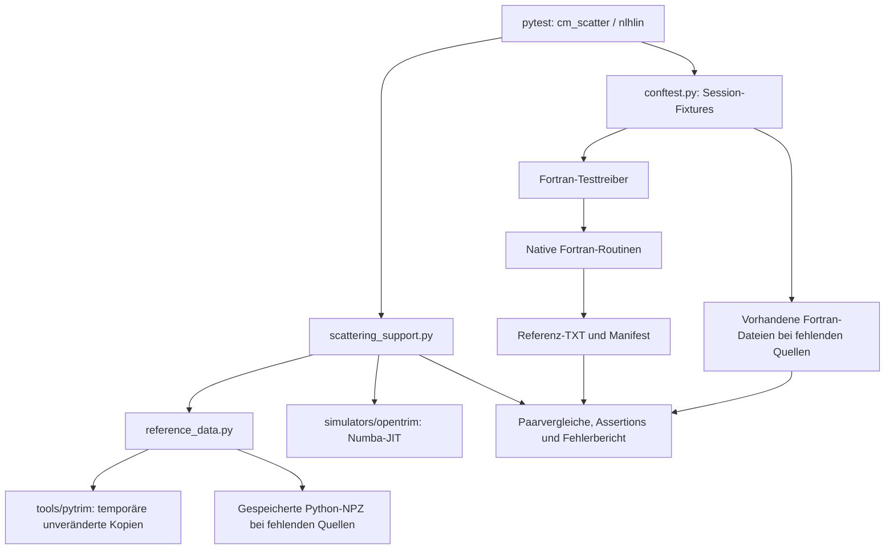

# Änderungen seit dem Clone und Funktionsweise der Versionsvergleiche

Stand: **25.10.2026**. Dieses Dokument beschreibt die aktuellen Arbeitskopien
`OpenSRIM/` und `imsil-omp/` im gemeinsamen übergeordneten Projektverzeichnis.
Es trennt Änderungen an den eigentlichen Programmen von der Testinfrastruktur.

## Inhalt

1. [Nachweisbarer Ausgangsstand und Umfang](#1-nachweisbarer-ausgangsstand-und-umfang)
2. [Änderungen am Versionscode](#2-änderungen-am-versionscode)
3. [Gemeinsame Größen, Eingaben und Datenfluss](#3-gemeinsame-größen-eingaben-und-datenfluss)
4. [Die einzelnen Streutests](#4-die-einzelnen-streutests-test_cm_scatterpy)
5. [Die einzelnen Screeningtests](#5-die-einzelnen-screeningtests-test_nlhlinpy)
6. [Gemeinsame Hilfsfunktionen](#6-gemeinsame-hilfsfunktionen-scattering_supportpy)
7. [Python-Loader und gespeicherte Python-Ergebnisse](#7-python-loader-und-gespeicherte-python-ergebnisse-reference_datapy)
8. [Fortran-Build und Referenzverwaltung](#8-fortran-build-und-referenzverwaltung-conftestpy)
9. [Aufgaben der Fortran-Treiber](#9-aufgaben-der-fortran-treiber)
10. [Toleranzen und Ergebnisberichte](#10-toleranzen-und-ergebnisberichte)
11. [Tests der Referenzinfrastruktur](#11-tests-der-referenzinfrastruktur-test_reference_datapy)
12. [Ausführung, Nachweise und Grenzen](#12-ausführung-nachweise-und-grenzen)

### 1.1 Vollständige Liste der geänderten versionierten Programmdateien

| Implementierung | Geänderte Datei | Schwerpunkt |
|---|---|---|
| Python | `OpenSRIM/tools/pytrim/cm_scatter.py` | Endlicher Winkelvorfaktor, stabile Winkelauswertung und degeneriertes Integrationsintervall |
| Numba | `OpenSRIM/simulators/opentrim/cm_scatter.py` | Cutoff im Integranden, Quadraturparameter, Apsis-Absicherung, stabile Winkelauswertung |
| Numba | `OpenSRIM/simulators/opentrim/nlhlin.py` | Vorzeichen der Screeningableitung |
| Fortran | `imsil-omp/code/sn/screen.f90` | NLHlin-Normierung, REAL8-Konstanten, Koeffizientenheader, Diagnoseausgaben |
| Fortran | `imsil-omp/code/sn/cmscatter.f90` | Cutoff-Grenzfall und stabiler endlicher Legendre-Winkel |
| Fortran | `imsil-omp/code/sn/cmangm.f90` | Cutoff-Rückgabe und genauere lokale Apsis für Mehler |


## 2. Änderungen am Versionscode

### 2.1 Python: `tools/pytrim/cm_scatter.py`

Die öffentliche Schnittstelle bleibt `setup(n_absc)` und
`scatter_integrals(e, p, screen_fun) -> (theta, tau)`.
`calc_phi_chi()` sowie die Plotfunktionen sind gegenüber dem Clone unverändert.

**Korrektur des endlichen Winkelvorfaktors.** Für `R=rmax` war ursprünglich

```text
theta = 2*acos(p/R) * (1 - Q)
```

implementiert. Korrekt ist die Trennung der geometrischen Anteile:

```text
A = 2*acos(p/R)
B = 2*acos(r0/R)
theta = A - B*Q
```

Dabei ist `Q` das normierte Winkelintegral. `p` ist der Stoßparameter, `r0`
die Apsis. Sie sind bei wechselwirkenden Teilchen im Allgemeinen verschieden.
Der ursprüngliche gemeinsame Faktor führte deshalb zu deutlichen
NLHlin-Winkelabweichungen.

**Numerisch stabile Auswertung.** Die aktuelle Implementierung berechnet diese
korrigierte Gleichung weiter umgeformt:

```text
sp = sqrt((R-p)*(R+p))
s0 = sqrt((R-r0)*(R+r0))
A-B = 2*asin((r0-p)*(r0+p)/(r0*sp+p*s0))
B   = 2*atan2(s0, r0)
theta = (A-B) + B*(1-Q)
```

Auch `1-Q` wird nicht durch Subtraktion fast gleicher Integralwerte gebildet.
Für `b=sqrt(2-u²)`, `rho=r0/(e*p²)` und `g=sqrt(b²+rho*chi)` verwendet die
lokale Funktion `integrands(u)` die Identität

```text
1/b - 1/g = rho*chi / (b*g*(g+b)).
```

Sie liefert jetzt neben Winkel- und Tau-Integrand diesen dritten Integranden
`correction`. Er ist eine algebraische Differenz, kein empirisch angepasstes
Korrekturergebnis.

**Integrationsgrenze und Grenzfall.** Bei endlichem Potential wird
`umax=sqrt((R-r0)/R)` statt `sqrt(1-r0/R)` berechnet. Die kleine Differenz wird
also vor der Division gebildet. Ist das Intervall auf null gerundet, werden
seine geometrischen Grenzwerte direkt zurückgegeben:

```text
theta = 2*atan2(sp, p)
tau   = r0 - p²/(R+sp).
```

Damit entfällt die Division durch eine verschwindende Quadratur-Normierung.
Bei unendlicher Reichweite ist `umax=1`; die bisherigen ZBL-Winkel- und
Tau-Gleichungen bleiben erhalten. Die übrige Tau-Formel wurde nicht durch eine
neue Quadratur ersetzt. Auch die bereits vorhandenen Rückgaben für `p>=R`
und für den zentralen Stoß bleiben bestehen.

### 2.2 Numba: `simulators/opentrim/nlhlin.py`

In `screen_fun(r, pot_coefs)` gilt innerhalb des Potentials

```text
phi(r)  = sum(a_i*exp(-b_i*r)) + c - d*r/rmax
phi'(r) = -sum(a_i*b_i*exp(-b_i*r)) - d/rmax.
```

Im Clone stand beim letzten Ableitungsterm fälschlich **`+d/rmax`**.
Dieser Term wurde auf **`-d/rmax`** korrigiert. Das beeinflusst nicht nur den
Ableitungsvergleich, sondern auch Newton-Schritte und den kleinen-u-Grenzwert
von `chi`.

### 2.3 Numba: `simulators/opentrim/cm_scatter.py`

#### `_integrands(u, e, p, r0, pot_model, pot_coefs)`

- Bei NLHlin werden Screeningwerte an Quadraturstellen mit `r>=rmax` auf null
  gesetzt. Das verhindert die Extrapolation des rohen Screeningkernels über
  seine endliche Reichweite hinaus.
- Die bestehende kleine-u-Taylorform von `chi` bleibt erhalten.
- Hinzu kommt der stabile Differenzintegrand. Mit
  `h=sqrt(r0/e*chi+p²*(2-u²))` und `b=sqrt(2-u²)` lautet er
  `(r0/e*chi)/(b*h*(h+p*b))`, also algebraisch `1/b-p/h`.
- Die private Funktion liefert jetzt drei statt zwei Arrays.

#### `scatter_integrals(e, p, pot_model, pot_coefs, n_absc=4)`

Der neue optionale Parameter `n_absc` erlaubt **4, 16, 32, 64, 128 oder 256**
Legendre-Punkte. Die Regeln werden außerhalb der JIT-Funktion einmalig in
`LEGENDRE_RULES` vorbereitet. Die Auswahl erfolgt bei jedem Aufruf über das
Argument; globale Arrays werden nach der Kompilierung nicht umgeschaltet.
`ROOTS_LEGENDRE` bleibt als Vierpunktregel verfügbar. Nicht unterstützte
Ordnungen führen zu `ValueError`.

Die finite Winkelauswertung verwendet dieselbe stabile Zerlegung wie Python,
mit Numbas entsprechend skaliertem Integranden. `umax`, die geometrischen
Wurzeln und der Fall eines leeren Integrationsintervalls werden ebenfalls
stabil ausgewertet.

#### `get_apsis(e, p, pot_model, pot_coefs)`

Neu beziehungsweise korrigiert sind:

1. Für `p>=rmax` direkte Rückgabe `(p, 0)`.
2. Die Newton-Restfunktion lautet jetzt
   `(r-p)*(1+p/r)-phi/e` statt `r-phi/e-p²/r`.
   Das ist algebraisch gleich, verliert für `r≈p` aber weniger Stellen.
3. Startwert und Folgeschritte werden für das repulsive Potential auf
   `r0>=p` und bei endlicher Reichweite zusätzlich `r0<=rmax` begrenzt.
   Es werden Iterierte abgesichert, nicht fertige Winkel im Test verändert.
4. Nichtendliche Restfunktion/Ableitung oder eine nichtpositive Ableitung
   führen zu `ValueError`.
5. Nach höchstens 100 Iterationen wird andernfalls ein `RuntimeError` ausgelöst.
6. Die relative Abbruchschwelle bleibt **1e-3**; geprüft wird jetzt der tatsächlich
   ausgeführte, gegebenenfalls begrenzte Schritt.

Der frühere negative Winkel unmittelbar unterhalb des Cutoffs war unter anderem
auf eine geringfügig unter `p` geratene Apsis zurückzuführen. Die Absicherung
verhindert diesen unphysikalischen Zwischenwert.

### 2.4 Fortran: `code/sn/screen.f90`

#### `initScreen()`

**Neue Screeninglängen-Auswahl `NLHlin`.** Sie verwendet

```text
rnorm_NLHlin = 0.4685/sqrt(sqrt(Z1)+sqrt(Z2))
a = aZBL/rnorm_NLHlin.
```

Der vorhandene allgemeine Umrechnungsweg `b *= aZBL/a` und
`rmax *= a/aZBL` ergibt dadurch genau
`b_file*rnorm_NLHlin` und `rmax_file/rnorm_NLHlin`.
So lassen sich dieselben ursprünglichen Koeffizienten wie in Python/Numba mit
gleichen reduzierten Radien auswerten.

**REAL8-Konstanten.** Screeninglängen und fest eingetragene Koeffizienten für
ZBLuniv, KrC und Moliere verwenden explizite `_real8`-Literale und
`real(...,REAL8)`-Umwandlungen. Die Dezimalwerte wurden nicht neu angepasst;
sie werden nun direkt in der vorgesehenen Genauigkeit statt zunächst in
Default-Real ausgewertet. Auch Firsov-/Lindhard-Ausdrücke wurden entsprechend
präzisiert.

### 2.5 Fortran: `code/sn/cmscatter.f90`

#### `cmAngle(...)`

- Die frühe Rückgabe gilt jetzt für **`p>=rmax`**, zuvor nur für `p>rmax`.
- Am Apsispunkt werden `phi0_save` und zusätzlich `dphi0_save` gespeichert.
- Für endliche Potentiale werden Integrationsgrenze und geometrische Winkel
  wie oben mit Differenzen vor der Division, faktorisierten Wurzeln und
  `atan2` bestimmt. Bei unendlicher Reichweite werden die geometrischen
  Winkelgrößen direkt auf `PI` gesetzt.
- Bei `umax_save==0` wird der geometrische Winkel direkt zurückgegeben.

#### !!!!!!!!!!!!!!!!!!!!!!!!!!!!!!!!!!!!!!!!!!!!!!!!!!!!!!!!!!!!!!!
#### Neue private Funktion `f_theta_deflection_legendre(u)`

Sie bildet den rationalisierten freien-minus-wechselwirkenden Integranden.
Für `u<3e-4` verwendet sie
`chi=phi0_save-r0_save*dphi0_save`; sonst die Screeningwert-Differenz.
Diese kleine-u-Grenzwertauswertung war im alten endlichen
`f_theta_chi_legendre`-Pfad nicht vorhanden, obwohl Python/Numba sie bereits
verwendeten. Es wird eine Funktion der Produktionsroutine stabilisiert,
nicht im Treiber ein Fortran-Ergebnis passend gerechnet.
#### !!!!!!!!!!!!!!!!!!!!!!!!!!!!!!!!!!!!!!!!!!!!!!!!!!!!!!!!!!!!!!!!!!!!!!!

### 2.6 Fortran: `code/sn/cmangm.f90`

`cmangm(theta, tau, e, p, r0, ielem1, ielem2)` bleibt die native
Gauss-Mehler-Routine. Sie wurde folgendermaßen geändert:

- Import und Verwendung von `get_rmax`; für `p>=rmax` direkte Rückgabe
  `theta=tau=0`.
- Kopieren der Eingabe-Apsis in `rturn` und lokale Newton-Verfeinerung mit der
  stabilen Restfunktion `(rturn-p)*(1+p/rturn)-phi/e`.
- Abbruch bei relativer Schrittweite `1e-12`; nach maximal 20 Schritten
  `error stop`, falls keine Konvergenz erreicht wurde.
- Verwendung von `rturn` in Radien, Winkel und Zeitintegral. Das als
  `intent(in)` übergebene `r0` wird nicht überschrieben.
- `sqrt(r0²-p²)` wird als `sqrt((rturn-p)*(rturn+p))` ausgewertet.

Die Verfeinerung ist nötig, weil hohe Mehler-Ordnungen nahe an die
Wurzelsingularität am Umkehrpunkt gelangen. Die allgemein verwendete
Fortran-Apsisroutine mit gröberem Abbruchkriterium wurde dabei nicht verändert.

## 3. Gemeinsame Größen, Eingaben und Datenfluss

### 3.1 Welche Implementierung wird verwendet?

| Rolle | Herkunft | Öffentliche Aufrufe |
|---|---|---|
| Reines Python | `OpenSRIM/tools/pytrim` | `setup`, `scatter_integrals`, `calc_phi_chi`, `ZBL_screen`, `NLHlin_screen` |
| Numba | `OpenSRIM/simulators/opentrim` | kompilierte `scatter_integrals`, `get_apsis`, Screeningkerne und native Koeffizientenloader |
| Fortran | `imsil-omp/code/sn` | `initScreen`, `screen`, `get_rmax`, `apsis`, `cmAngle`, `initCmangm`, `cmangm`, für Legacy-ZBL außerdem `cmangl`/`timeint` |

`e` und `p` sind reduzierte Energie und reduzierter Stoßparameter; `r0` ist die
Apsis, `R=rmax` der Cutoff. `theta` wird in Radiant verglichen, `tau` in der
jeweiligen gemeinsamen reduzierten Längeneinheit. Python/Fortran liefern theta,
Numba liefert pi minus theta. Der Testadapter wandelt nur diese Konvention um.

Für B–Si sind die Normierungen:

```text
ZBL:    0.4685/(5**0.23 + 14**0.23)
NLHlin: 0.4685/sqrt(sqrt(5) + sqrt(14)).
```

Alle NLHlin-Tests verwenden denselben 3-eV-Koeffizientensatz. Die Python-Dateien
werden unverändert in ein temporäres Verzeichnis kopiert, dort wird der
Datensatz unter dem vom ursprünglichen Python-Loader erwarteten Namen
`dmol_coeffs_rmax.dat` abgelegt. Die Quell- oder Originaldatendateien werden
dabei nicht umgeschrieben.

### 3.2 Ablauf eines Vergleichs


#### !!!!!!!!!!!!!!!!!!!!!!!!!!!!!!!!!!!!!!!!!!!!!!!!!!!!!!!!!!!!!!!!!!!!!!!!!!!!!!!!!!
Pro Prüfgröße werden Python/Numba, Python/Fortran und Numba/Fortran verglichen.
Die Tests ersetzen keine Streuintegrale durch eigene Implementierungen. Erlaubte
Adapter sind die Winkelkonvention, die Auswahl gemeinsamer Koeffizienten,
Einheitenumrechnung und die ausdrücklich dokumentierte Screening-/Chi-Diagnose.
Nichtendliche Ergebnisse werden als Fehler behandelt, nicht repariert.
#### !!!!!!!!!!!!!!!!!!!!!!!!!!!!!!!!!!!!!!!!!!!!!!!!!!!!!!!!!!!!!!!!!!!!!!!!!!!!!!!!!!

### 3.3 Wiederverwendete Eingabegitter

| Bezeichnung | Eingaben |
|---|---|
| Standardpaar | Z1=5, Z2=14 |
| Chi-Apsispunkte | r0 = 0.01, 0.1, 1, 10 |
| Chi normal | 999 u-Werte von 0.001 bis 0.999 |
| Chi nahe null | 101 logarithmische u-Werte von 1e-10 bis 1; letzter Wert durch `nextafter(1,0)` ersetzt |
| Chi nahe eins | entsprechendes logarithmisches Gitter für 1-u, anschließend u=1-(1-u) |
| Fehler-/Integralgrids | e=1e-4, 0.1, 100; jeweils 101 p-Werte von 0.02 bis 30, 12 beziehungsweise 4 |
| tau-gegen-theta | sechs logarithmische Energien 1e-4 bis 10; 201 p-Werte von 0.02 bis 30 |
| sin²(theta/2) | sieben logarithmische Energien 1e-4 bis 100; 201 p-Werte von 0.01 bis 30 |
| Zusätzliche Paare | (1,1), (79,79), (1,79), (5,14); e=1e-4, 0.1, 100; p=0.02, 0.1, 0.5, 1, 2, 3, 4 |
| Randfälle | e=0.001, 0.1, 10; p=1e-8, 1e-6, 1e-4; zusätzlich für ZBL 0.01, 0.02, 0.03, 0.04 und für NLHlin R*(1-1e-4), R*(1-1e-6), R*(1-1e-8), `nextafter(R,-inf)` |
| Konvergenz | e=0.01, 1, 10; ZBL p=0.02, 0.1, 1, 3, 10, 20, 30; NLHlin p/R=0.01, 0.1, 0.3, 0.5, 0.9, 0.99, 0.999 |

## 4. Die einzelnen Streutests: `test_cm_scatter.py`

Es gibt 14 Testfunktionen, aus denen durch Parametrisierung **36 Testfälle**
werden. Namen mit `model` laufen für ZBL und NLHlin. Die Grundtests verwenden
`build_and_run_f90`, die drei erweiterten Funktionen `extended_fortran`.
#### !!!!!!!!!!!!!!!!!!!!!!!!!!!!!!!!!!!!!!!!!!!!!!!!!!!!!!!!!!!!!!!!!!!!!!!!!!!!!!!!!!
| Testfunktion | Fälle | Exakte Aufgabe / Referenz |
|---|---:|---|
| `test_chi_python_numba_fortran` | 2 | Vergleicht die Chi-Screeningdiagnose für alle vier r0 auf dem normalen u-Gitter; `chi_{model}_r0_{index}.txt`. |
| `test_chi_near_zero_python_numba_fortran` | 2 | Gleiche Diagnose auf dem logarithmischen u-Gitter, einschließlich des Taylorbereichs; `chi_{model}_near_zero_r0_{index}.txt`. |
| `test_chi_near_one_python_numba_fortran` | 2 | Diagnose für u nahe eins; die Dateikoordinate ist 1-u; `chi_{model}_near_one_r0_{index}.txt`. |
| `test_head_on_scattering_angle_python_numba_fortran` | 2 | p=0 bei sieben Energien. Paarvergleich und zusätzlich theta=pi für jede Version. Tau wird hier nicht verglichen. |
| `test_scattering_at_and_beyond_cutoff_python_numba_fortran` | 1 | NLHlin bei p=R, direkt oberhalb R und p=30. theta und tau müssen exakt null sein. Numbas direkter Apsis-Aufruf muss `(p,0)` liefern. |
| `test_scatter_integrals_python_numba_fortran` | 2 | theta und tau auf den drei Fehlergittern; Python/Numba Legendre 4, Fortran theta Legendre 4 und tau Mehler 512; `scatter_native_*`. |
| `test_tau_error_data_python_numba_fortran` | 2 | Verbindlicher Dreiwegevergleich des unveränderten tau. Python 32 wird zusätzlich berechnet und als Diagnose ausgegeben; dessen Abweichungen werden hier nicht als Konvergenzschranke behauptet. |
| `test_tau_over_theta_data_python_numba_fortran` | 2 | Prüft die beiden Koordinaten theta und tau separat auf dem Plotgitter. „Über theta“ bedeutet eine Plotachse, nicht tau/theta. Die historischen Dateinamen `scatter_ratio_*` enthalten trotzdem nur p, theta, tau. |
| `test_sinhalftheta_over_p_data_python_numba_fortran` | 2 | Bildet aus jedem nativen theta den physikalischen Faktor sin²(theta/2) und vergleicht ihn auf dem p-Gitter; keine Division durch p; `theta_sin_*`. |
| `test_theta_error_data_python_numba_fortran` | 6 | Zwei Modelle × drei Energien. Vergleicht direkt die Vierpunktwinkel aus `theta_error_*_n4.txt`. Der Testname bedeutet hier keinen Vergleich mit einer exakten analytischen Lösung. |
| `test_scatter_tau_python_numba_fortran` | 1 | Nur ZBL: vergleicht Python/Numba mit beiden Fortran-Tabellenroutinen `cmangl` und `timeint`, jeweils separat und mit eigenem absolutem Fehlerbudget; `tau_zbl_*`, `tau_timeint_zbl_*`. |
| `test_additional_element_pairs_python_numba_fortran` | 8 | Zwei Modelle × vier Paare. theta und tau auf dem zusätzlichen Paargitter; `pairs_{model}_{Z1}_{Z2}_n512.txt`. |
| `test_small_impact_and_inside_cutoff_python_numba_fortran` | 2 | Beide Größen auf dem Randgitter. Zusätzlich endliche Apsis innerhalb p<=r0<=R, höchstens 100 Numba-Iterationen und Winkel in [0,pi] mit Rundungsspielraum 1e-11. Eingabepunkte müssen bitgleich mit dem Fortran-Gitter sein. |
| `test_tau_accuracy_and_convergence_python_numba_fortran` | 2 | Verbindliche Genauigkeits- und Konvergenzprüfung auf dem Konvergenzgitter; Details unten. |
#### !!!!!!!!!!!!!!!!!!!!!!!!!!!!!!!!!!!!!!!!!!!!!!!!!!!!!!!!!!!!!!!!!!!!!!!!!!!!!!!!!!

### 4.2 Verbindlicher Tau-Konvergenztest

Für jede Energie werden folgende Rechnungen unverändert aufgerufen:

- Python mit 4, 32, 64 und 128 Legendre-Punkten.
- Numba mit 4, 16, 32, 64, 128 und 256 Punkten sowie zusätzlich ohne
  Ordnungsargument. 
- Fortran-tau mit 512, 2048, 8192, 32768, 131072 und 524288 Mehler-Punkten.

Verbindlich verglichen werden Python 64/128, Numba 64/128 und 128/256 sowie
Fortran 131072/524288. Anschließend folgt der Dreiwegevergleich von
**Python 128, Numba 128 und Fortran 524288**. Für tau gilt jeweils
`rtol=1e-3, atol=1e-6`. Die Unterschiede niedrigerer Ordnungen werden zusätzlich
berichtet. Sie werden weder extrapoliert noch zur Anpassung der Ergebnisse
verwendet. Die hohen Fortran-Ordnungen gelten nur für diese Testkonfiguration,
nicht als neue Vorgabe für alle Simulationen.

## 5. Die einzelnen Screeningtests: `test_nlhlin.py`

Zwei Testfunktionen werden mit drei Konfigurationen parametrisiert, insgesamt
**sechs Testfälle**:

- `test_plot_screen_data_python_numba_fortran`: NLHlin-Screeningwert und Ableitung.
- `test_plot_zblscreen_data_python_numba_fortran`: ZBL-Screeningwert und Ableitung.

Beide delegieren an **`compare_screening(model, config_index, directory)`**.
Diese Funktion führt den vollständigen Vergleich aus:

1. Sie läuft über Z1=1 bis 92. Für die ersten zwei Konfigurationen gilt Z2=Z1,
   für die dritte Z2=29.
2. Die Konfigurationen sind `(p1,p2,Z2_fix)` = `(0,0,None)`,
   `(0.23,1,None)`, `(0.5,2/3,29)`.
   Im ersten Fall ist die Testnormierung 1, sonst
   `rnorm=0.4685/(Z1**p1+Z2**p1)**p2`.
3. Für NLHlin ist das Testgitter `linspace(0,3/rnorm,101)`. Python wird direkt
   mit dieser Normierung aufgebaut. Numba-Radien werden mit
   `factor=rnorm/native_norm` umgerechnet; seine Ableitung wird mit demselben
   Faktor multipliziert (Kettenregel).
4. Bei ZBL ist das Testgitter stets die physikalische Länge 0 bis 3 Å.
   Python erhält `grid/native_norm` und seine Ableitung wird durch
   `native_norm` geteilt. Numba benutzt `factor=1/native_norm`.
   Die ersten beiden ZBL-Konfigurationen prüfen deshalb dieselben Paare auf
   demselben physikalischen Gitter; sie sind keine zwei unabhängigen ZBL-Normierungen.
5. Die Fortran-Datei muss 101 Zeilen mit den Spalten Radius, phi und dphi
   enthalten; die Radien werden vor dem Vergleich kontrolliert.
6. Für phi und dphi werden alle drei Backendpaare mit `rtol=1e-10, atol=1e-11`
   verglichen.

#### !!!!!!!!!!!!!!!!!!!!!!!!!!!!!!!!!!!!!!!!!!!!!!!!!!!!!!!!!!!!!!!!!!!!!!!!!!!!!!!!!!
## 6. Gemeinsame Hilfsfunktionen: `scattering_support.py`

[scattering_support.py](scattering_support.py) bündelt Eingaben, Backendaufrufe,
Dateiprüfungen und Berichte. Dadurch müssen die Tests weder dieselbe Ausgabe
noch dieselben Vergleichsschleifen mehrfach implementieren.

| Funktion | Aufgabe |
|---|---|
| `get_python_screen_fun(model)` | Erzeugt die Python-Screeningbeschreibung für Bor/Silizium mit der zum Modell passenden Normierung. |
| `build_numba_potential(model)` | Lädt native Numba-Parameter über `defaults.toml` und `init_params.get_params`, wählt B/Si und kontrolliert, dass ein JIT-kompilierter Aufruf verwendet wird. |
| `all_models()` | Liefert die vorbereiteten Modelle für die Parametrisierung. |
| `chi_u_values()` | Liefert das reguläre Chi-Gitter mit 999 Punkten von 0.001 bis 0.999. |
| `chi_near_zero_u_values()` | Liefert 101 logarithmische Werte ab `1e-10`; ersetzt den Endpunkt 1 durch die nächstkleinere Gleitkommazahl. |
| `chi_near_one_values()` | Erstellt das entsprechende Gitter in `1-u` und die dazugehörigen Werte von `u`. |
| `calculate_scatter(...)` | Berechnet Python und Numba auf demselben Stoßparametergitter. |
| `calculate_scatter_python(...)` | Ruft die Python-/Cache-Schnittstelle mit der gewählten Legendre-Ordnung auf. Ergebnisform: `(2, Anzahl p)` für Theta und Tau. |
| `calculate_scatter_numba(...)` | Ruft den nativen Numba-Kernel für jeden Stoßparameter auf. Ohne explizite Ordnung wird dessen Standardaufruf benutzt. Wandelt ausschließlich die Rückgabekonvention `pi-theta` in Theta um. |
| `assert_arrays_equal(...)` | Verlangt endliche Werte auf beiden Seiten und führt `assert_allclose` mit expliziten Toleranzen und `equal_nan=False` aus. |
| `load_fortran_data(...)` | Liest eine klassische Referenzdatei, prüft Existenz, Zeilen-/Spaltenzahl und Übereinstimmung der Eingabespalte mit dem angeforderten Gitter. |
| `record_max_error(...)` | Sammelt absolute und relative Maximalabweichungen samt Koordinaten, Werten und Kontext. Zählt außerdem nichtendliche Werte und Nullreferenzen. Die lokale Funktion `location` ordnet einen Arrayindex seinen Eingabekoordinaten zu. |
| `print_results(...)` | Gibt die gesammelten Vergleichsstatistiken, optionale Zähler und Erläuterungen einheitlich aus. |
| `compare_three_way(...)` | Vergleicht Python/Numba, Python/Fortran und Numba/Fortran. Wählt die mengenabhängigen Toleranzen, protokolliert Fehler und setzt die Auswertung der übrigen Punkte fort. |
| `finish_comparison(...)` | Druckt den vollständigen Bericht und lässt den Test bei gesammelten Fehlern scheitern; die Fehlermeldung nennt die Anzahl und die ersten drei Detailmeldungen. |
| `evaluate_numba_screen(...)` | JIT-kompilierter Screeningadapter: ruft den nativen Kernel innerhalb seiner Reichweite auf und liefert außerhalb Null. Dies bildet die Cutoff-Behandlung des Aufrufers ab. |
| `compare_chi_reference(...)` | Vergleicht die Chi-Diagnostik für vier Umkehrabstände mit Python und Fortran-Dateien. Die lokale Funktion `screen_nb` passt skalare/Array-Eingaben an den Numba-Screeningadapter an. |
| `coefficient_template()` | Liefert einmalig einen nativen Numba-Koeffizientendatensatz als Strukturvorlage. |
| `numba_coefficients(...)` | Kopiert die Vorlage, leert die Koeffizientenfelder und befüllt sie aus der nativen Koeffizientenroutine des gewählten Modells/Elementpaars; liefert auch die native Normierung. |
| `pair_inputs(...)` | Stellt Python-Screeningbeschreibung und Numba-Koeffizienten für dasselbe Elementpaar bereit. |
| `extended_grid(...)` | Definiert gemeinsam die Energie-/Stoßparametergitter für Elementpaare, Grenzfälle und Konvergenz. |
| `extended_outputs(...)` | Liest erweiterte Fortran-Dateien mit vier Spalten, prüft Energien und Stoßparameter und formt die Ergebnisse zu `(Anzahl Energien, 2, Anzahl p)` um. Am Grenzgitter müssen die Stoßparameter exakt passen. |
#### !!!!!!!!!!!!!!!!!!!!!!!!!!!!!!!!!!!!!!!!!!!!!!!!!!!!!!!!!!!!!!!!!!!!!!!!!!!!!!!!!!
Die Funktionen verändern keine berechneten Ergebnisse, um Vergleiche passend
zu machen. Die Umrechnung von Winkelkonventionen und Längeneinheiten sowie die
Screening-Cutoff-Konvention sind dagegen notwendige Schnittstellenanpassungen.
`diagnostic_chi` ist ausdrücklich eine Diagnoseformel und kein zusätzlicher
Numba-Streuwinkelsolver.

#### !!!!!!!!!!!!!!!!!!!!!!!!!!!!!!!!!!!!!!!!!!!!!!!!!!!!!!!!!!!!!!!!!!!!!!!!!!!!!!!!!!
## 7. Python-Loader und gespeicherte Python-Ergebnisse: `reference_data.py`

[reference_data.py](reference_data.py) trennt die Python-Implementierung von
Numba-Importen und ermöglicht Vergleiche bei fehlendem Python-Quellcode.

| Funktion/Klasse | Aufgabe |
|---|---|
| `python_modules()` | Prüft die fünf Dateien `table1d.py`, `apsis.py`, `zbl.py`, `nlhlin.py`, `cm_scatter.py`. Vorhandener ausführbarer Python-Code muss aus `OpenSRIM/tools/pytrim` stammen. Kopiert die Dateien unverändert in eine temporäre Installation und lädt sie dort mit isolierten Modulnamen. Temporäre Importaliase werden danach zurückgesetzt. |
| `python_result(kind, parameters, grid, compute)` | Gemeinsamer Weg für Live-Berechnung und gespeicherte Ergebnisse. Bei vorhandenem Code wird immer neu gerechnet und gespeichert. Bei fehlendem Code wird ausschließlich eine zu den Eingaben passende Datei gelesen. |
| `coefficient_rows()` | Liest die kanonische Koeffiziententabelle einmal und stellt die Zeilen nach Elementpaar bereit. |
| `PythonScreen.__init__(...)` | Speichert Modell, Elementpaar und Normierung; erstellt bei vorhandenem Code die originale Screeningklasse. Bestimmt die Reichweite auch ohne Python-Quellcode aus der Koeffiziententabelle. |
| `PythonScreen.__call__(radii)` | Berechnet oder lädt Phi und seine Ableitung über `python_result`. |
| `python_scatter(...)` | Die lokale Funktion `compute` setzt die native Python-Quadraturordnung mit `setup`, ruft `scatter_integrals` für alle Stoßparameter auf und gibt Theta/Tau zurück. Energie und Ordnung sind Bestandteil der Cache-Eingaben. |
| `python_chi(...)` | Berechnet oder lädt die originale Python-Funktion `calc_phi_chi`; auch `r0` gehört zu den gespeicherten Eingaben. |
| `diagnostic_chi(...)` | Wertet die Chi-Plotdiagnostik mit einer übergebenen Screeningfunktion aus: für `u < 3e-4` die Taylorgrenze `phi0-r0*dphi0`, sonst den Differenzenquotienten. |

Die temporäre Installation erhält die unveränderte kanonische Tabelle
`OpenSRIM/data/NLHlin/NLHlin_3eV.dat` unter dem vom Python-Lader erwarteten
Namen `dmol_coeffs_rmax.dat`. Das ist eine Auswahl der Eingabedatei, keine
Änderung am Python-Programm oder an seinen Koeffizientenwerten.

Gespeichert wird unter `tests/data/py/reference_v1/` als
`<kind>_<SHA256 der Eingabemetadaten>.npz`.

#### !!!!!!!!!!!!!!!!!!!!!!!!!!!!!!!!!!!!!!!!!!!!!!!!!!!!!!!!!!!!!!!!!!!!!!!!!!!!!!!!!!
# 8. Fortran-Build und Referenzverwaltung: `conftest.py`

[conftest.py](conftest.py) enthält sitzungsweite pytest-Fixtures. Ein benötigter
Referenzsatz wird daher innerhalb eines Testlaufs nur einmal vorbereitet.

| Funktion/Fixture | Aufgabe |
|---|---|
| `digest(path)` | Berechnet den SHA256-Inhaltsprüfwert einer Datei. |
| `cached_fortran(directory, group, reason)` | Prüft vorhandene Referenzen bei fehlender Buildmöglichkeit oder ausdrücklich gewähltem Cachebetrieb. Mit Manifest werden Koeffizienten-Hash und Hashes aller dort aufgeführten Ergebnisdateien geprüft. |
| `generate_fortran(...)` | Sammelt Produktionsquellen aus `srcs.mk` ohne `main.f90`, ergänzt Treiber und gemeinsame Testmodule, baut und startet sie in einer temporären Umgebung und veröffentlicht erfolgreiche Ergebnisse samt Manifest. |
| `build_and_run_f90()` | Erstellt den klassischen CM-Referenzsatz mit ZBL- und NLHlin-Treiber sowie gemeinsamem Ausgabemodul. |
| `screening_fortran()` | Baut und startet `screen_reference.f90` für die Screeningvergleiche. |
| `extended_fortran()` | Baut `scatter_extended.f90` einmal und startet getrennte Prozesse für die angeforderten Modelle, Paare und Mehler-Ordnungen. |

Der Standardquellpfad ist das benachbarte `imsil-omp/`; Der Build benutzt direkt
`gfortran` mit `-g -O0 -fcheck=all -fbacktrace -Wall`, Modulverzeichnis und
Präprozessoroption `-cpp`. `dirs.mk` und das dort konfigurierte Hauptprogramm
werden dafür nicht benötigt. Build und einzelne Programmläufe haben jeweils
ein Zeitlimit von 600 Sekunden. Logs werden im Ergebnisverzeichnis abgelegt.

| Gruppe | Ausgabeort relativ zu `OpenSRIM/tests/` |
|---|---|
| `cm` | `data/f90/` |
| `screening` | `data/f90/screening/` |
| `extended` | `data/f90/extended/` |

Wenn Compiler, Quellen oder erforderliche Treiber fehlen, werden passende
vorhandene Referenzen verlangt. `OPEN_SRIM_FORTRAN_MODE=cached` wählt dies
explizit. Ein tatsächlicher Compiler- oder Laufzeitfehler bei vorhandenen
Quellen führt hingegen zum Fehlschlag, nicht zur stillen Nutzung alter Daten.
Fehlen sowohl Code als auch Referenzen, scheitert der Test ebenfalls.

Das Manifest `<group>_manifest.json` enthält Schema, Koeffizienten-Hash,
Programmlaufargumente, Quellpfade/-Hashes und Prüfsummen der Ergebnisdateien.
Die gespeicherten Quellcode-Hashes werden im Ersatzbetrieb nicht gegen einen
vorgegebenen Versionsstand geprüft. Alte Referenzordner ohne Manifest werden
noch akzeptiert, wenn Textdateien existieren; die Tests prüfen dann ihre
konkreten Dateien und Eingabegitter. Diese Kompatibilität bietet weniger
Herkunftssicherheit als ein Manifest.

## 9. Aufgaben der Fortran-Treiber

Die Treiber sind Testinfrastruktur: Sie wählen Eingaben, rufen native
Fortran-Routinen auf und schreiben deren Ausgaben. Die Integrationsalgorithmen
bleiben in den Produktionsmodulen `screen`, `cmscatter` und `cmangm`.

### 9.1 Klassische CM-Treiber

Unter `imsil-omp/code/unittests/sn/cmscatter/` liegen:

- `test_cm_scatter_f90.f90`: ZBL-Vergleiche für B/Si, Chi-Diagnostik,
  Winkelwerte für mehrere Legendre-Ordnungen sowie Tau-/Sinus-Daten.
- `test_cm_scatter_nlhlin_f90.f90`: entsprechende NLHlin-Werte, zusätzlich
  Screening-/Umkehrpunktdiagnostik. Verwendet die kanonische Normierung und
  die native analytische Screeningableitung.
- `cm_scatter_comparison_data.f90`: gemeinsames Modul; seine Routine
  `write_comparison_data(model)` schreibt die für die vereinheitlichten
  Vergleiche benötigten Datensätze.

Die Chi-Diagnostik des ZBL-Treibers berechnet die Ableitung durch finite
Differenzen mit `h=1e-6*max(1,r0)` (zentral, soweit möglich, sonst vorwärts).
Beim NLHlin-Treiber stammt sie aus der nativen Screeningroutine. Daher ist
nicht jede Chi-Abweichung ausschließlich ein Unterschied der Screeningwerte.

Das gemeinsame Modul verwendet die Mehler-Ordnung 512. Es erzeugt
Kopfstoßdaten, NLHlin-Cutoffdaten und die Dateien mit Theta/Tau auf den
Energie-/Stoßparametergittern der Haupttests. Dateien `scatter_ratio_*`
enthalten Koordinaten Theta und Tau; der Name bezeichnet keinen im Test zu
vergleichenden Quotienten.

### 9.2 `tests/fortran/scatter_extended.f90`

[scatter_extended.f90](fortran/scatter_extended.f90) erhält Modell,
Ordnungszahl 1, Ordnungszahl 2 und Mehler-Ordnung als Argumente. Es initialisiert
Screening und Quadratur und erzeugt die Gruppen `pairs`, `boundary` und
`convergence`. Für Ordnungen ungleich 512 wird nur `convergence` geschrieben.

Für jede Energie und jeden Stoßparameter wird der Winkel über die native
LegendreChiCorr-Methode mit vier Punkten ermittelt. Für Tau wird der native
Umkehrpunkt berechnet und an `cmangm` übergeben; dessen zusätzlich berechneter
Winkel wird für diesen Vergleich nicht verwendet. Eine Ergebniszeile enthält
`Energie, Stoßparameter, Theta, Tau`. Der Dateiname kodiert Gruppe, Modell,
Elementpaar und Mehler-Ordnung.

### 9.3 `tests/fortran/screen_reference.f90`

[screen_reference.f90](fortran/screen_reference.f90) erzeugt ausschließlich
Screeningreferenzen. Es durchläuft zwei Modelle, drei Konfigurationen und
jeweils 92 Elementpaare. Die Konfigurationen entsprechen genau denen aus
`test_nlhlin.py`; Radius- und Ableitungseinheiten werden passend dazu gewählt.

Die native Routine `initScreen` wird für das jeweilige Paar initialisiert,
anschließend liefert `screen` Phi und Ableitung für 101 Radien. Es entstehen
552 Dateien nach dem Muster `screen_<modell>_c<konfiguration>_z<z1>.txt` mit
den Spalten `Radius, Phi, Ableitung`. Der Treiber enthält keine zweite
Implementierung der Screeningformel.

## 10. Toleranzen und Ergebnisberichte

Geprüft wird elementweise die Bedingung

```text
abs(Ergebnis - Referenz) <= atol + rtol * abs(Referenz)
```

Die Standardbudgets aus `scattering_support.py` sind:

| Größe | Mit Numba: `(rtol, atol)` | Python/Fortran: `(rtol, atol)` |
|---|---|---|
| Chi | `(1e-8, 1e-10)` | `(1e-8, 1e-10)` |
| Theta | `(3e-4, 1e-11)` | `(1e-8, 2e-11)` |
| `sin(theta/2)**2` | `(5e-4, 1e-10)` | `(1e-8, 1e-11)` |
| Tau | `(1e-3, 1e-7)` | `(1e-3, 0.025)` |
| Exakte Grenzfälle | `(0, 1e-14)` | `(0, 1e-14)` |

Für Tau mit Fortran gilt auch im Paar Numba/Fortran das Fortran-Budget.
Ein Test kann dafür ein ausdrückliches engeres Budget übergeben. Die älteren
Tau-Integrationsvergleiche verwenden beispielsweise `(1e-3, 0.015)`;
Konvergenzprüfungen verwenden `(1e-3, 1e-6)`. Screeningtests verwenden ihre
eigene feste Tabelle `(1e-10, 1e-11)` für Phi und Ableitung, ohne die globalen
Streutoleranzen zu verändern. Die konkreten zusätzlichen Konvergenzassertions
stehen im jeweiligen Test und sind nicht mit den allgemeinen Tau-Budgets
gleichzusetzen.

Die Berichte nennen für jedes Backendpaar getrennt maximale absolute und
relative Abweichungen, Eingabekoordinaten und zugehörige Werte. Diese Maxima
können an unterschiedlichen Punkten auftreten. Kontextangaben unterscheiden
Modell, Energie, Elementpaar oder Quadraturordnung. Fehler werden gesammelt,
damit nicht nur der erste problematische Punkt sichtbar wird.

## 11. Tests der Referenzinfrastruktur: `test_reference_data.py`

[test_reference_data.py](test_reference_data.py) prüft nicht die Physik,
sondern die Verlässlichkeit des Ladens und Erzeugens der Vergleichsdaten:

| Test/Helfer | Geprüftes Verhalten |
|---|---|
| `test_python_loader_rejects_alternative_sources` | Vorhandener Python-Code aus einem anderen Verzeichnis wird abgelehnt; ein fehlender Quellpfad aktiviert den vorgesehenen Ersatzbetrieb. |
| `test_python_cache_roundtrip_and_input_validation` | Ein Live-Ergebnis lässt sich bei fehlendem Code wieder laden; geänderte Eingaben oder Metadaten werden nicht still akzeptiert. Die lokale Funktion `unavailable` simuliert fehlenden Python-Code. |
| `make_fortran_cache` | Erstellt für Infrastrukturtests einen kleinen Referenzsatz mit passendem Manifest. |
| `test_missing_fortran_source_preserves_reference` | Bei fehlenden Quellen werden vorhandene geprüfte Daten verwendet und nicht überschrieben; manipulierte Ergebnisdateien werden erkannt. |
| `test_missing_fortran_and_missing_reference_fail` | Ohne Quellen und ohne gespeicherte Referenzen wird ein klarer Fehler gemeldet. |
| `test_fortran_build_failure_does_not_fall_back_or_delete` | Ein simulierter Buildfehler darf weder auf alte Daten ausweichen noch vorhandene Referenzen löschen. Die lokale Funktion `broken` simuliert den fehlgeschlagenen Compileraufruf. |

Diese fünf Tests ergänzen die 36 Streu- und sechs Screeningfälle.

## 12. Ausführung, Nachweise und Grenzen

Aus dem gemeinsamen übergeordneten Projektverzeichnis können die drei
Testmodule mit der vorhandenen Umgebung so ausgeführt werden:

```bash
PYTEST_DISABLE_PLUGIN_AUTOLOAD=1 .venv_numba/bin/python -m pytest \
  OpenSRIM/tests/test_cm_scatter.py \
  OpenSRIM/tests/test_nlhlin.py \
  OpenSRIM/tests/test_reference_data.py -v -s
```

Bei aktivierter geeigneter virtueller Umgebung kann stattdessen `python`
verwendet werden. `-s` zeigt die Vergleichsberichte. Beim normalen Lauf werden
vorhandener Python-Code und baubares Fortran tatsächlich ausgeführt; das
Vorhandensein alter Referenzen allein schaltet diese Berechnungen nicht ab.
Numba und die kanonische Koeffiziententabelle werden auch im Ersatzbetrieb
weiter benötigt.

1. Wie wird geprüft, ob Fortran vorhanden ist?

In [generate_fortran() (line 54)](/home/thomas/Documents/OpenSRIM/OpenSRIM/tests/conftest.py:54) geschieht das schrittweise:
- Der Quellpfad ist standardmäßig imsil-omp/; OPEN_SRIM_FORTRAN_SOURCE kann ihn überschreiben.
- src_list.is_file() prüft, ob code/srcs.mk existiert.
- shutil.which('gfortran') prüft, ob der Compiler verfügbar ist.
- Aus srcs.mk werden die Produktionsquellen gelesen. main.f90 wird ausgeschlossen, weil der jeweilige Testtreiber das Hauptprogramm stellt.
- all(p.is_file() for p in sources + driver_paths + common_paths) prüft anschließend jede benötigte Quelle einschließlich Treibern und gemeinsamen Modulen.
Fehlt etwas, prüft [cached_fortran() (line 28)](/home/thomas/Documents/OpenSRIM/OpenSRIM/tests/conftest.py:28) gespeicherte Ergebnisse. Mit Manifest müssen Koeffizienten-Hash und Ergebnisprüfsummen stimmen. Alte Dateien ohne Manifest bleiben zulässig; ihre Eingabegitter prüfen die Tests.

Wichtig: Sind die Quellen vorhanden, aber Kompilierung oder Programmlauf scheitern, schlägt der Test fehl. Es wird dann nicht auf alte Ergebnisse ausgewichen. Auch fehlende Laufzeittabellen führen beim Live-Betrieb zum Fehler.

2. Was bedeutet die temporäre Python-Kopie?

[python_modules() (line 38)](/home/thomas/Documents/OpenSRIM/OpenSRIM/tests/reference_data.py:38) kopiert diese fünf Dateien unverändert aus tools/pytrim in ein temporäres Verzeichnis:

table1d.py, apsis.py, zbl.py, nlhlin.py, cm_scatter.py.

Daneben wird NLHlin_3eV.dat unter dem Namen dmol_coeffs_rmax.dat abgelegt. Das ist nötig, weil der originale Python-Lader genau diesen Dateinamen neben seiner eigenen Quelldatei erwartet.

Damit kann der unveränderte Programmcode mit dem gemeinsamen Koeffizientensatz laufen, ohne Dateien im Originalverzeichnis umzubenennen. Temporäre Importaliase stellen sicher, dass beispielsweise from apsis import Apsis die passende Python-Kopie lädt. Danach werden die vorherigen Aliase wiederhergestellt.

Die Installation bleibt innerhalb des Prozesses verfügbar und wird normalerweise beim Prozessende automatisch entfernt. Die geladenen Module werden wiederverwendet.
