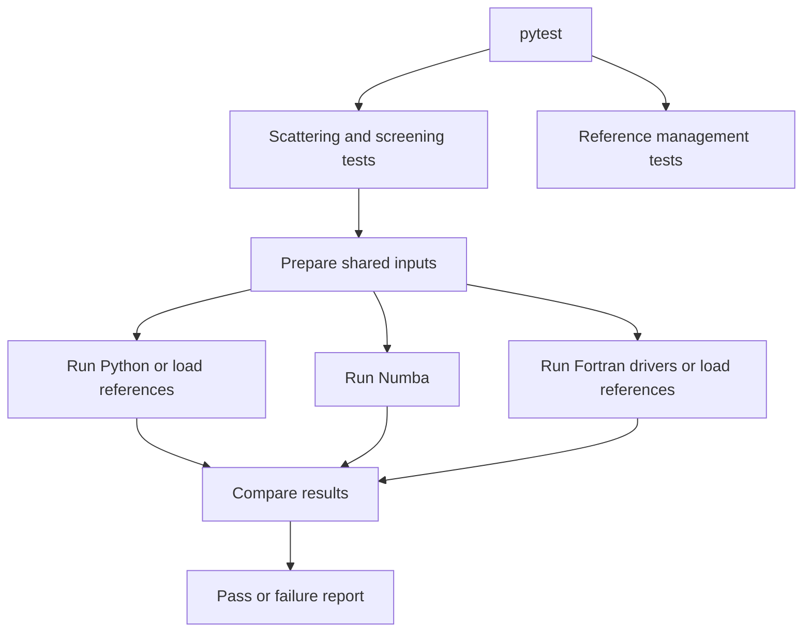

# Test structure

The tests check whether Python, Numba and Fortran produce consistent screening
and scattering results for the same inputs. Additional tests validate the reference files.

The comparison tests select the model, element pair and input grid. They then
obtain results from all three versions, align units and compare each backend
pair within specified tolerances. Saved results are called **references** and
are validated before use. Numba also runs when cached references are used.

Key quantities: `p` is the impact parameter, `r0` the distance of closest
approach and `rmax` the potential range. `phi` denotes screening, `chi` an
auxiliary integration quantity, `theta` the scattering angle and `tau` the time integral.

## 1. The tests

### Scattering: `test_cm_scatter.py`

[test_cm_scatter.py](test_cm_scatter.py) compares ZBL and NLHlin. Most tests
use boron on silicon `(Z1=5, Z2=14)` with four Legendre points.
The three error grids use energies `1e-4`, `0.1`, `100`, each with 101 impact
parameters from `0.02` to `30`, `12` or `4`, respectively.

| Test | What does it check? |
| --- | --- |
| [`test_chi_python_numba_fortran`](test_cm_scatter.py#L65) | Chi at four reference radii (`0.01, 0.1, 1, 10`) on 999 evenly spaced integration points. Checks basic agreement for this auxiliary quantity. |
| [`test_chi_near_zero_python_numba_fortran`](test_cm_scatter.py#L85) | Chi on a logarithmic grid containing very small u values. In particular, checks stable evaluation of the limit near zero. |
| [`test_chi_near_one_python_numba_fortran`](test_cm_scatter.py#L109) | Chi on a logarithmic grid for `1-u`. Checks evaluation near the upper integration boundary. |
| [`test_head_on_scattering_angle_python_numba_fortran`](test_cm_scatter.py#L132) | Head-on collisions with `p=0` at seven energies. All angles must equal pi; Tau is not compared here. |
| [`test_scattering_at_and_beyond_cutoff_python_numba_fortran`](test_cm_scatter.py#L171) | NLHlin only: impact parameters at and beyond the potential range. Theta and Tau must be exactly zero. Numba must return the apsis without iteration. |
| [`test_scatter_integrals_python_numba_fortran`](test_cm_scatter.py#L228) | Theta and Tau on the three error grids with four Legendre points. Checks both scattering quantities together. |
| [`test_tau_error_data_python_numba_fortran`](test_cm_scatter.py#L267) | Tau from all three four-point calculations. An additional Python calculation with 32 points provides diagnostics; its deviation is not an additional pass criterion. |
| [`test_tau_over_theta_data_python_numba_fortran`](test_cm_scatter.py#L315) | Theta and Tau at six energies with 201 impact parameters each. Both quantities are checked separately; the name refers to a plot, not `tau/theta`. |
| [`test_sinhalftheta_over_p_data_python_numba_fortran`](test_cm_scatter.py#L357) | `sin(theta/2)**2` calculated from the angles at seven energies. It is considered as a function of impact parameter, not divided by it. |
| [`test_theta_error_data_python_numba_fortran`](test_cm_scatter.py#L396) | Theta on each error grid, separately for each model and energy. Compares four-point results with the Fortran angle files. |
| [`test_scatter_tau_python_numba_fortran`](test_cm_scatter.py#L434) | Tau on the error grids with 32 Legendre points in all three versions. Checks agreement at a higher order. |
| [`test_additional_element_pairs_python_numba_fortran`](test_cm_scatter.py#L464) | Theta and Tau for H/H, Au/Au, H/Au and B/Si at three energies and seven impact parameters. Checks additional element combinations. |
| [`test_small_impact_and_inside_cutoff_python_numba_fortran`](test_cm_scatter.py#L504) | Very small impact parameters and, for NLHlin, points immediately inside the potential range. Also checks a finite apsis between p and rmax, at most 100 Numba iterations, and angles between zero and pi with rounding allowance. |

### Screening: `test_extended_element_pairs.py`

[test_extended_element_pairs.py](test_extended_element_pairs.py) checks the
screening function and its derivative:

- **[`test_nlhlin_screening_python_numba_fortran`](test_extended_element_pairs.py#L135):** Compares NLHlin and also
  requires screening and its derivative to be zero beyond the potential range.
  Exactly at the cutoff, only the derivative is excluded from the comparison.
- **[`test_zbl_screening_python_numba_fortran`](test_extended_element_pairs.py#L160):** Compares ZBL screening and
  its derivative after conversion to the same physical radius units.

Both use `compare_screening()`. Each configuration checks 92 element pairs
with 101 radii each. Two configurations pair each element with itself; the
third pairs it with copper (`Z2=29`). Normalizations are defined in
`CONFIGURATIONS`; the first two ZBL configurations check the same physical
cases. The Fortran file shape and radius grid are checked before comparing values.

### Reference management: `test_setup.py`

[test_setup.py](test_setup.py) checks loading and validation mechanisms using
temporary files and deliberately induced failures. An expected exception
means that the test passes.

| Test | What does it check? |
| --- | --- |
| [`test_python_loader_uses_original_files_from_any_cwd`](test_setup.py#L19) | The correct Python source files and coefficients are loaded regardless of the working directory; existing module aliases are preserved. The test is skipped if sources are unavailable. |
| [`test_python_loader_rejects_alternative_sources`](test_setup.py#L60) | A different complete Python source directory is rejected. A missing directory instead signals that cached references may be used. |
| [`test_python_cache_roundtrip_and_input_validation`](test_setup.py#L93) | Saving and reloading work. Changed inputs, modified results, and missing or invalid manifests are rejected. |
| [`test_missing_fortran_source_preserves_reference`](test_setup.py#L201) | Without Fortran sources, valid references are used without modification. Altered files are detected through their hashes. |
| [`test_missing_fortran_and_missing_reference_fail`](test_setup.py#L237) | An error is reported if both sources and references are missing. |
| [`test_fortran_rejects_old_diagnostic_or_mehler_cache`](test_setup.py#L265) | The `cm` and `extended` groups require the current calculation identifier. Matching file hashes alone are insufficient. |
| [`test_fortran_build_failure_does_not_fall_back_or_delete`](test_setup.py#L301) | A compiler failure must neither be hidden by falling back to old references nor delete existing data. |

The validation mechanisms themselves are implemented in `reference_data.py`
and `conftest.py`. They also run during normal reference access.

## 2. Python files supporting the tests

### `scattering_support.py`

[scattering_support.py](scattering_support.py) groups together grids, model
parameters, tolerances and comparison functions. It calls Python and Numba,
reads Fortran tables and produces error reports.

Key functions include `pair_inputs()` for element pairs,
`extended_grid()` for additional grids, `calculate_scatter()` for calculations
and `compare_three_way()` for the three pairwise comparisons.
The Numba adapter converts its `pi-theta` return value to Theta.

Comparisons use `abs(result-reference) <= atol + rtol*abs(reference)`.
RTOL is the relative tolerance; ATOL allows small absolute differences,
especially near zero. Nonfinite values cause a failure.

### `reference_data.py`

[reference_data.py](reference_data.py) loads the standalone Python modules
and manages their references. `PythonScreen`, `python_scatter()` and
`python_chi()` provide consistent interfaces for the tests.

`python_result()` computes new values and saves them as NPZ when sources are
available. Otherwise, it loads existing data. The file hash and complete input
metadata must match. `reference_filename()` builds readable filenames;
`python_manifest.json` contains the result file hashes.

### `conftest.py`

[conftest.py](conftest.py) automatically provides Fortran preparation.
The `build_and_run_f90`, `screening_fortran` and `extended_fortran` fixtures
prepare their respective reference groups once per test session.

`generate_fortran()` compiles the production sources with the test drivers,
stages tables and publishes successful outputs along with a manifest.
If sources or the compiler are missing, `cached_fortran()` validates saved
references. An actual build failure remains a failure; existing data must not hide it.

## 3. Fortran files: reference data generators

These programs use the Fortran production routines. They write results;
comparisons and pass/fail decisions are subsequently made by pytest.

| File | Purpose |
| --- | --- |
| [scattering_reference_writers.f90](fortran/scattering_reference_writers.f90) | Shared module: `write_chi_data()` writes Chi grids; `write_comparison_data()` writes angle and time-integral data. The model must already be initialized. |
| [generate_zbl_scattering_references.f90](fortran/generate_zbl_scattering_references.f90) | Initializes ZBL for boron/silicon and calls the shared writing routines. |
| [generate_nlhlin_scattering_references.f90](fortran/generate_nlhlin_scattering_references.f90) | Initializes NLHlin for boron/silicon using the shared coefficient table and calls the same writing routines. |
| [generate_extended_scattering_references.f90](fortran/generate_extended_scattering_references.f90) | Takes the model, both atomic numbers and quadrature order as arguments. Generates additional pair and boundary grids, with one file per energy. |
| [generate_screening_references.f90](fortran/generate_screening_references.f90) | Generates Phi and its derivative for both models, three configurations and 92 pairs each. Radii and derivatives are converted to the units used by the screening tests. |

Comments such as `scattering_support.extended_grid` refer to the corresponding
Python grid definition. Fortran does not call that function. When changing a
grid, both definitions must be updated consistently.

The additional scripts [analysis/correction/analyze.py](analysis/correction/analyze.py)
and [analysis/correction/fortran.py](analysis/correction/fortran.py) investigate
variants of the angle integrand. They are not part of the normal pytest run.
Details of saved files and their naming are documented in
[data/reference_files.md](data/reference_files.md).

## 4. Added `correction` term

A `correction` term was added to all three implementations for the angle
calculation with finite-range potentials:

- Python: [tools/pytrim/cm_scatter.py](../tools/pytrim/cm_scatter.py#L87), in `integrands()`.
- Numba: [simulators/opentrim/cm_scatter.py](../simulators/opentrim/cm_scatter.py#L70), in `_integrands()`.
- Fortran: [code/sn/cmscatter.f90](../../imsil-omp/code/sn/cmscatter.f90#L132), in `f_theta_deflection_legendre()`.

It evaluates the difference between the free-motion and interacting angle
integrands in an algebraically equivalent but numerically more stable form.
For weak deflections, both values are nearly equal, so direct subtraction can
lose significant precision. The reformulated calculation avoids this
cancellation and improves the evaluation of small scattering angles, especially
near the NLHlin cutoff. The term is not an empirical correction factor; its
scaling is adapted to each implementation. It is used in the finite-range
angle branch, not to correct Tau.
